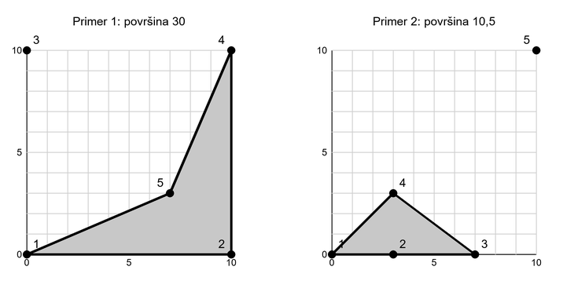

Radi popularizacije sporta i rekreacije, škola planira izgradnju sportskog centra za svoje učenike. Za tu svrhu dobila je veliko parče zemljišta. Pre početka izgradnje, potrebno je najpre ograditi četvorougaoni deo zemlje. Komisija je odredila optimalnu površinu sportskog centra $P$. Međutim, to nije sve, ogradu nije moguće postaviti bilo gde na zemljištu, već je određen spisak dozvoljenih lokacija koje mogu biti temena četvorougla.

Vaš zadatak je da odraberete četiri dozvoljena temena, tako da površina ograđenog zemljišta **bude što bliža $P$**.

## Opis ulaza

U prvom redu standardnog ulaza nalazi se broj $n$, koji predstavlja broj dozvoljenih lokacija. U drugoj liniji nalazi se prirodan broj $P$, optimalna površina zemljišta. Svaka od narednih $n$ linija sadrži po dva nenegativna cela broja $x$ i $y$, koordinate jedne dozvoljene lokacije.

## Opis izlaza

U prvom i jedinom redu standardnog izlaza ispisati jedan pozitivan realan broj - najbliža moguća površina koju je moguće dobiti. Broj ispisati sa tačno dve cifre iza decimalne tačke. Ukoliko su dve vrednosti podjednako udaljene od optimalne, **ispisati veću**.

## Primer 1

### Ulaz

```
5

30

0 0

10 0

0 10

10 10

7 3
```

### Izlaz

```
30.00
```

## Primer 2

### Ulaz

```
5

10

0 0

3 0

7 0

3 3

10 10
```

### Izlaz

```
10.50
```

## Objašnjenje primera

U prvom primeru možemo postići traženu površinu postavljanjem ograda od prve do druge lokacije, druge do četvrte, četvrte do pete i pete do prve. U drugom primeru nije moguće dobiti traženu vrednost, a najbližu možemo postići ako postavimo ograde od prve do druge lokacije, druge do treće, treće do četvrte i četvrte do prve.



## Ograničenja

- $0 \leq P \leq 10^{18}$.

Test primeri su podeljeni u tri disjunktne grupe:

- U test primerima koji vrede $10$ poena važiće $n \leq 5$ i $0 \leq x, y \leq 10$.
- U test primerima koji vrede $30$ poena važiće $n \leq 100$ i $0 \leq x, y \leq 10^9$.
- U test primerima koji vrede $60$ poena važiće $n \leq 200$ i $0 \leq x, y \leq 10^9$.

## Napomena

Površina mora biti veća od nule, to jest nije dozvoljeno izabrati četiri kolinearne lokacije. Dozvoljeno je izabrati četiri tačke tako da tri od njih budu kolinearne, kao u drugom primeru. Četvorougao ne sme biti samopresecajući.
