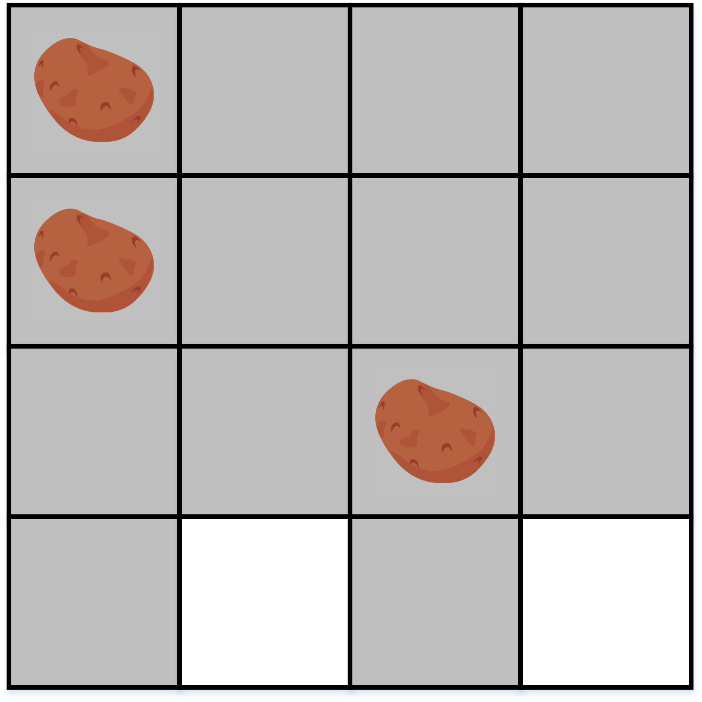

Mars. Druga najmanja planeta Solarnog sistema, prečnika dva puta manjeg od Zemlje čija je godina otprilike dva puta duža od Zemljine, planeta koja poseduje dva prirodna satelita i drugu najvišu planinu u Sunčevom sistemu. Slučajnost? Tako ne misli Mateja Dejmon, astro-botaničar koji je greškom ostao ostavljen na ovoj planeti kada je peščana oluja omela istraživačku misiju Ares $3$.

On na raspolaganju ima svoju bazu, nekoliko kila krompira i plodno marsovsko zemljište dimenzije $N \times N$ metara koje je on izdelio na $N^2$ polja dimenzija $1 \times 1$ metar (raspoređenih u $N$ redova i $N$ kolona) a zatim posadio $M$ krompira u nekih $M$ polja (tih $M$ polja ćemo zvati **početna polja**). Međutim, zbog posebnog sastava marsovskog zemljišta, **krompir je, osim na $M$ početnih polja, izrastao i na svakom polju u čijem se redu ili koloni nalazilo bar jedno od $M$ početnih polja.**

**Ukoliko vam je poznato gde je Mateja posadio krompire**, pomozite mu da izračuna **na koliko je ukupno polja izrastao krompir** kako bi procenio svoje zalihe za čekanje na misiju Ares $4$.

## Opis ulaza

U prvom redu standardnog ulaza nalaze se dva prirodna broja $N$ i $M$, razdvojena razmakom, koja redom predstavljaju dimenziju zemljišta i broj početnih polja na kojima je zasađen krompir. Zatim sledi opis početnih polja: u narednih $M$ redova nalaze se po dva prirodna broja $x_i$ i $y_i$, razdvojena razmakom, koja označavaju da je $i$-ti krompir zasađen u polju koje se nalazi u $x_i$-tom redu (gledano odozgo nadole) i $y_j$-toj koloni (gledano s leva nadesno).

## Opis izlaza

U prvom i jedinom redu standardnog izlaza treba ispisati jedan prirodan broj - ukupan broj polja na kojima je izrastao krompir.

## Primer 1

### Ulaz

```
4 3
1 1
2 1
3 3
```

### Izlaz

```
14
```

## Primer 2

### Ulaz

```
3 1
2 2
```

### Izlaz

```
5
```

## Objašnjenje primera

U prvom test primeru je $N = 4$ i $M = 3$, tj. Mateja Dejmon je zasadio 3 krompira čije su početne pozicije prikazane na slici. Na istoj slici su sivom bojom označena sva polja na kojima je izrastao krompir i njih ima ukupno 14 što je rešenje za ovaj primer. U drugom primeru krompir neće izrasti u u ugaonim poljima zemljišta $3 \times 3$ a u svim ostalim hoće.



## Ograničenja

- $1 \leq N \leq 10^6$
- $1 \leq x_i, y_i \leq N$
- Sva početna polja su različita

Test primeri su podeljeni u $4$ disjunktne grupe:

- U test primerima koji vrede $20$ poena važi $M = 2$.
- U test primerima koji vrede $30$ poena važi $1 \leq M \leq 500$, $1 \leq N \leq 500$.
- U test primerima koji vrede $20$ poena važi $1 \leq M \leq 5000$.
- U test primerima koji vrede $30$ poena važi $1 \leq M \leq 10^5$.

## Napomena

Obratite pažnju da je za rešenje potrebno koristiti $64$-bitni tip podataka.
