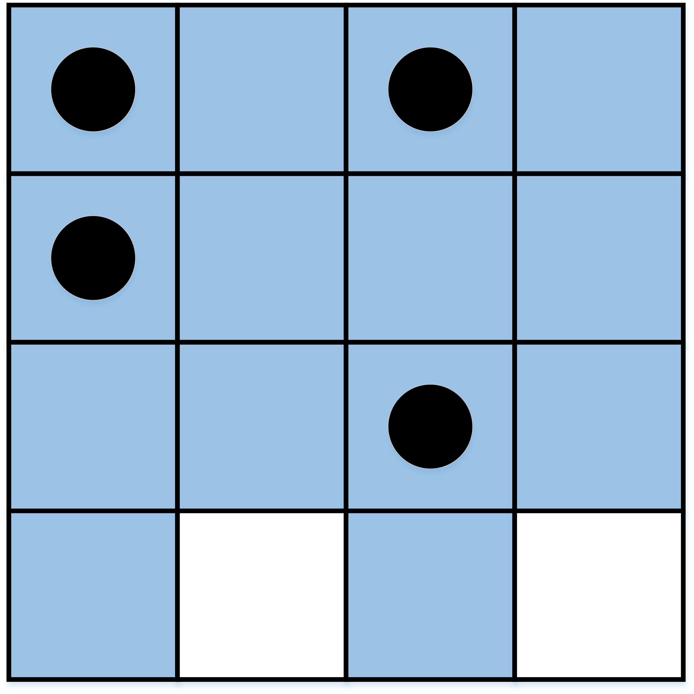

Mars. Četvrta planeta od Sunca, nazvana po Rimskom bogu rata, poznata i kao "crvena planeta" zbog gvožđe(III)oksida koji preovlađuje na njenoj površini, planeta čiji je astronomski simbol ujedno i simbol za muški rod, čiji dan traje $24$ sata i $40$ minuta i za koju se priča da poseduje podzemne vode. Zašto su ove informacije bitne za zadatak? Nisu.

Kako priča obično ide, ljudska ekspedicija je sletela na Mars i odmah oformila bazu. Baza se nalazi na površini dimenzije $N \times N$ metara koja je, radi lakše navigacije, izdeljena na $N^2$ kvadratnih sektora dimenzija $1 \times 1$ metar (raspoređenih u $N$ redova i $N$ kolona). Ekspedicija, poučena klasičnim skaj-faj filmovima, želi da osigura bazu da ih ne bi iznenadilo neko opasno stvorenje poput Ejliena, Marvina Marsovca, Džona Kartera ili Meta Dejmona. To će odraditi tako što će u nekim sektorima postaviti senzore. Kažemo da je sektor **siguran** ukoliko se **u njegovom redu ili u njegovoj koloni nalazi bar jedan sektor sa senzorom** (naravno, iz ovoga sledi da su i sektori sa senzorima sigurni).

Pomozite ekspediciji da postavi senzore **tako da tačno $M$ sektora bude sigurno**. Zašto $M$, a ne svi? Zato što tada ne bi bilo mesta iznenađenjima, a tako skaj-faj filmovi ne funkcionišu.

## Opis ulaza

U prvom i jedinom redu standardnog ulaza nalaze se dva prirodna broja $N$ i $M$, razdvojena razmakom, koja, redom, predstavljaju dimenziju baze i broj sektora koji mora koji moraju biti sigurni.

## Opis izlaza

Ukoliko je nemoguće postaviti senzore tako da tačno $M$ sektora bude sigurno, u prvom i jedinom redu ispisati $-1$. U suprotnom, u prvom redu ispisati broj senzora $K$, a zatim u narednih $K$ redova opisati gde treba postaviti te senzore: u svakom redu po dva prirodna broja $x_i$ i $y_i$ koja označavaju da $i$-ti senzor treba postaviti u sektoru koji se nalazi u preseku $x_i$-te kolone i $y_i$-te vrste. Vrste su numerisane od $1$ do $N$ odozgo nadole, a kolone su numerisane od $1$ do $N$ sleva nadesno. U svakom sektoru sme biti najviše jedan senzor. Ukoliko ima više rešenja, ispisati bilo koje.

## Primer 1

### Ulaz

```
4 14
```

### Izlaz

```
4
1 1
1 3
2 1
3 3
```

## Primer 2

### Ulaz

```
10 24
```

### Izlaz

```
-1
```

## Objašnjenje primera

U prvom test primeru je $N = 4$ i $M = 14$, tj. traži se da tačno 14 sektora bude sigurno. Ovo je moguće postići i na slici je prikazan jedan od načina koji odgovara izlazu za ovaj primer. Crnim tačkama su označene pozicije senzora dok su sigurni sektori obojeni i ima ih tačno 14. Postoje i drugačija (tačna) rešenja. U drugom primeru nikako nije moguće obezbediti da baza $10 \times 10$ ima tačno 24 sigurna sektora pa je odgovor '-1' (bez navodnika).



## Ograničenja

- $1 \leq M \leq 10^{12}$.

Test primeri su podeljeni u $4$ disjunktne grupe:

- U test primerima koji vrede $10$ poena važi $1 \le N \leq 3$.
- U test primerima koji vrede $20$ poena važi $1 \leq N \leq 1000$, $M \leq 4N$.
- U test primerima koji vrede $25$ poena važi $1 \leq N \leq 10^6$.
- U test primerima koji vrede $45$ poena važi $1 \leq N \leq 10^{18}$.
