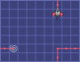

Након што су ти прсти, масни од Смокија, склизнули са управљача и нехотице притиснули дугме на коме је писало "ворп-спид", твој свемирски брод, Миленијумски Соко Штарк, нашао се изгубљен у ворп-спејсу. Љуљање брода узроковано јаким гравитационим таласима убрзо је учинило да добијеш морску болест. Не желећи да полусварени Смоки заврши на командама твог брода, притискаш дугме са натписом "Тутањ!", које те у најкраћем могућем времену одводи до излаза из ворп-спејса, а то је ворм-хол чији се други крај налази у твом wc-у на планети Земљи.
 <!-- Ovo je zato što se u Areni ne prikazuju razmaci između paragrafa! -->
 
Пар деценија раније, у 2019. години, ево тебе како програмираш свој будући свемирски брод. Познавајући свој слаб стомак, предвиђаш ситуацију у којој ћеш хитно морати да напустиш ворп-спејс, те желиш да напишеш програм који ће твој број одвести до излаза у што краћем времену.
 
 
Ворп-спејс има облик табеле димензија $D_x \times D_y$ ($D_x$ је број колона, а $D_y$ је број врста). На једном од поља ворп-спејса се налази твој брод, и на једном од поља се налази излаз (брод и излаз могу бити и на истом пољу). У једној јединици времена твој брод може да пређе на неко од суседна четири поља ворп-спејса (горе, доле, лево или десно). Међутим, ворп-спејс је уврнут, па **ако се нађеш на пољу уз његову ивицу и покушаш да се помериш у правцу те ивице, осванућеш на пољу које се налази на супротној страни ворп-спејса**. Прецизније, ако се налазиш у првој врсти и покушаш да идеш горе, појавићеш се у истој колони, али у последњој врсти; и обрнуто, ако се налазиш у последњој врсти и покушаш да идеш доле, појавићеш се у истој колони, али у првој врсти. Слично важи и за лево и десно - померањем у лево у првој колони, завршићеш у последњој колони исте врсте; и обрнуто, померањем у десно у последњој колони, завршићеш у првој колони исте врсте.
 
 
Верујеш да ће твој стомак умирити и просто сазнање колико је твој брод удаљен од излаза из ворп-спејса, па за прву верзију програма желиш да израчунаш само то - минимално потребно време да брод дође до излаза.
 
 

## Опис улаза

У првој линији налазе се цели бројеви $D_x$ и $D_y$, који представљају број колона и број врста ворп-спејса. У другој линији налазе се цели бројеви $A_x$ и $A_y$, који представљају колону и врсту у којој се налази твој брод. У трећој линији се налазе цели бројеви $B_x$ и $B_y$, који представљају колону и врсту у којој се налази излаз. Бројеви врста и колона почињу од $0$.

## Опис излаза

У јединој линији излаза исписати тачно један број - минимално потребно време да твој брод доведеш до излаза.

## Пример 1

### Улаз

~~~
6 6
0 3
2 2 
~~~

### Излаз

~~~
3
~~~

### Објашњење

До излаза ћеш најбрже доћи у три јединице времена, на пример тако што идеш једном на горе и два пута на десно

## Пример 2

### Улаз

~~~
9 7
6 1
1 5 
~~~

### Излаз

~~~
7
~~~

### Објашњење

Једно од могућих најкраћих решења је приказано на слици.

## Ограничења

* $1 \leq D_x, D_y \leq 1000$
* $0 \leq A_x, B_x < D_x$
* $0 \leq A_y, B_y < D_y$

## Напомене

* Од Чоко-Смокија се мање масте прсти.
* Соко Штарк није спонзор овог задатка.
