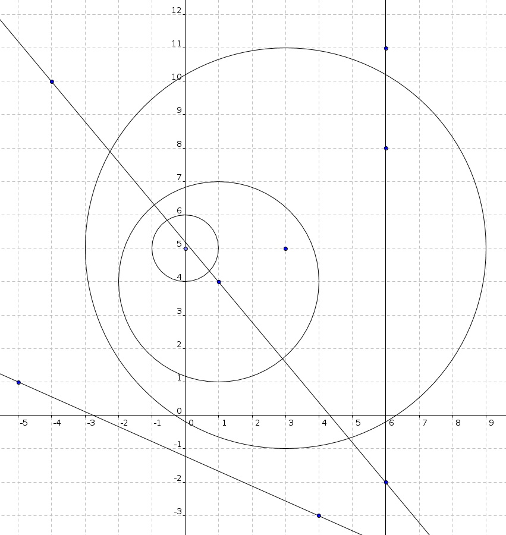

У једном предграђу Ниша налази се велика, такорећи бесконачна њива у облику дводимензионе равни. Богата породица Ватренић се не подноси са другом богатом породицом Блажић. Породица Блажић поседује $N$ оптичких каблова, $i$-ти кабл је у облику бесконачне праве која пролази кроз тачке $(x_i, y_i)$ и $(u_i, v_i)$. Ватренићи су познати по паљењу њива, те је ваш задатак да за сваки од датих $Q$ сценарија ширења пожара одредите колико каблова ће се оштетити. Сценарио са редним бројем $j$ се односи на један круг $K_j$ са центром у тачки $(a_j, b_j)$ и радијусом $r_j$, круг до којег ће се раширити пожар у том сценарију. Притом, за ове кругове важи: $K_j \subset K_{j+1}$ за свако $1 \leq j < Q$, другим речима, $j$-ти круг је у потпуности садржан у $(j+1)$-ом кругу, такође, границе никоја два круга се не додирују. Кабл који је у облику праве $p$ ће се оштетити у сценарију $C$ ако и само ако је скуп $p \cap C$ непразан, односно, ако се круг и права секу у бар једној тачки. Како је ватра непредвидива појава, у сваком сценарију **се гарантује да се решење (број оштећених каблова) неће променити чак ни ако се полупречник круга $r$ повећа или смањи за $r \cdot 10^{-12}$.**

## Опис улаза

У првој линији стандардног улаза налази се природан број $N$ - број каблова које поседује породица Блажић. У наредних $N$ линија налазе се по четири цела броја, $x_i, y_i, u_i, v_i$, координате две тачке кроз које пролази $i$-ти кабл. Наредна линија садржи један природан број $Q$, број сценарија. У наредних $Q$ редова налазе се по три цела броја $a_i, b_i, r_i$, координате центра круга и полупречник круга код $i$-тог сценарија.

## Опис излаза

За сваки од $Q$ сценарија исписати по један цео број - у $j$-ти ред исписати број каблова који ће се оштетити у сценарију под редним бројем $j$.

## Пример 1

### Улаз

~~~
4
4 -3 -5 1
6 -2 -4 10
6 11 6 8
6 8 6 11
3
0 5 1
1 4 3
3 5 6
~~~

### Излаз

~~~
1
1
3
~~~

### Објашњење примера

У прва два сценарија ће се оштетити само један кабл (кабл са редним бројем $2$), док ће се у трећем сценарију поред овог оштетити и каблови са редним бројевима $3, 4$ (који су подударни).

### Ограничења

У свим тест примерима важи:

* $-10^8 \leq x_i, y_i, u_i, v_i, a_j, b_j \leq 10^8$ за свако $1 \leq i \leq N, 1 \leq j \leq Q$ 
* $1 \leq r_j \leq 10^8$ за свако $1 \leq j \leq Q$
* $N, Q \leq 100000$.
* За свако $1 \leq i \leq N$ важи да се тачке $(x_i, y_i)$ и $(u_i, v_i)$ не подударају.

Тест примери су подељени у следеће групе:

* У тест примерима вредним 20 поена: $N, Q \leq 500$.
* У тест примерима вредним 20 поена: $a_i = a_j, b_i = b_j$ за свако $1 \leq i, j \leq Q$.
* У тест примерима вредним 20 поена: $y_i = v_i$ за свако $1 \leq i \leq N$.
* У тест примерима вредним 40 поена: Нема додатних ограничења.
