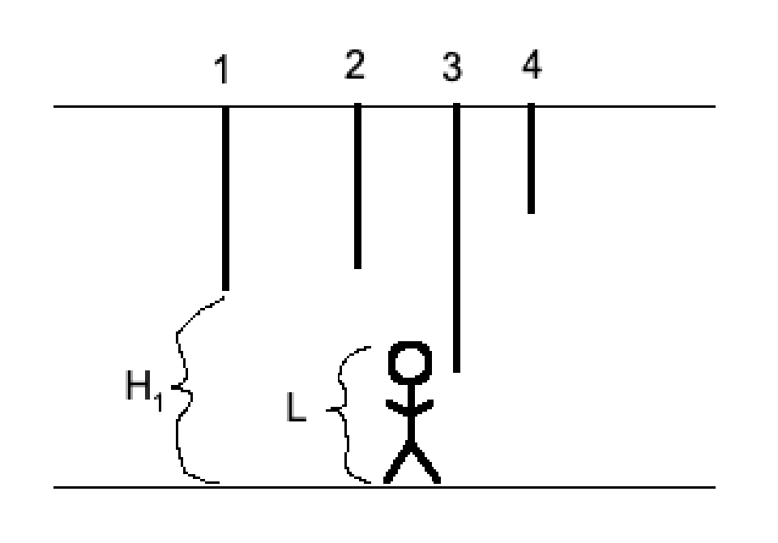

<br>

Млади програмер Перица једног сунчаног дана је наишао на пећину. Перица као знатижељни дечак кренуо је у истрагу те пећине. Када је ушао открио је да се ту налази тачно $N$ сталактита, који су индексирани од $1$ до $N$ редом. Познато је да се $i$-ти сталактит налази на висини $H_i$ у односу на земљу. Последњи пут када је Перица мерио своју висину, она је износила тачно $L$. 

<br>

Перица је ушао у пећину и ходао док није наишао на сталактит који не може да заобиђе. Прецизније, он може да прође поред сталактита уколико се најнижи део сталактита налази изнад њега. 

<br>

Ваш задатак је да помогнете Перици и да одредите редни број, односно индекс сталактита где би се он зауставио. Уколико Перица може да прође кроз целу пећину, онда је потребно исписати `-1`.

<br>
На слици испод је приказан први пример:

<br>

  

<br>

## Опис улаза

<br>

У првом реду стандардног улаза, налазе се два природна броја $N$ и $L$, који представљају број сталактита и Перичину висину, респективно. У другом и последњем реду стандардног улаза се налазе $N$ природних бројева, где $i$-ти број представља $H_i$ - висину $i$-тог сталактита.

<br>

## Опис излаза

<br>

У првој и јединој линији стандардног излаза исписати редни број, односно индекс траженог сталактита, или $-1$ уколико он не постоји.

<br>

## Пример 1

<br>

### Улаз

<br>

```
4 5
7 8 4 10
```

<br>

### Излаз

<br>

```
3
```

<br>

### Објашњење

<br>

Са слике у тексту задатка се види да Перица стиже до трећег сталактита, па је у овом примеру потребно исписати $3$.

<br>

## Пример 2

<br>

### Улаз

<br>

```
3 6
10 6 4
```

<br>

### Излаз

<br>

```
2
```

<br>

### Објашњење

<br>

Уколико је сталактит исте висине као Перица, сматра се да ће га Перица закачити, те да не може да прође даље.

<br>

### Пример

<br>

### Улаз

<br>

```
4 5
9 10 6 7
```

<br>

### Излаз

<br>

```
-1
```

<br>

## Ограничења

<br>

* $1 \leq N \leq 1\,000$

* $1 \leq L,H_i \leq 10^9$

<br>

Тест примери су подељени у четири дисјунктне групе:

* У тестовима вредним 10 поена: $N = 5$ и $H_1 = H_2 = \ldots = H_n$.

* У тестовима вредним 40 поена: $N = 5$.

* У тестовима вредним 10 поена: гарантује се да ће Перица стићи или до последњег сталактита или ће проћи кроз целу пећину.

* У тестовима вредним 40 поена: без додатних ограничења.

<br>
