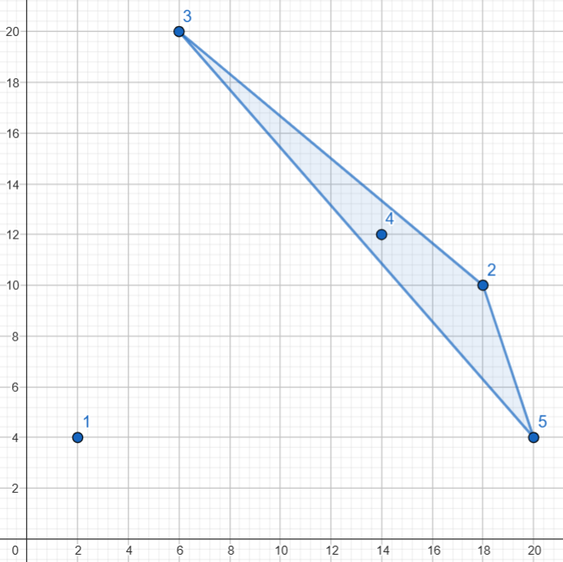
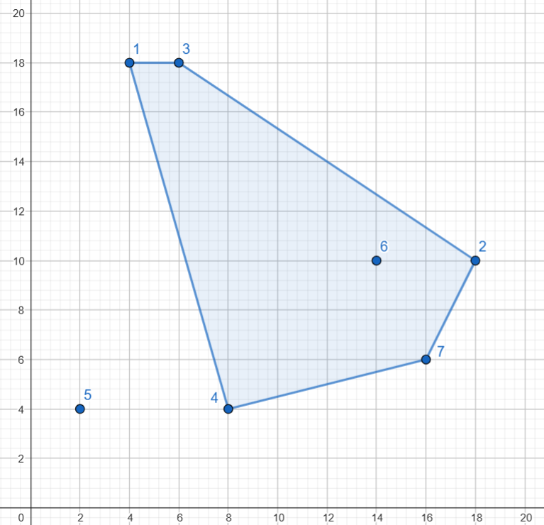
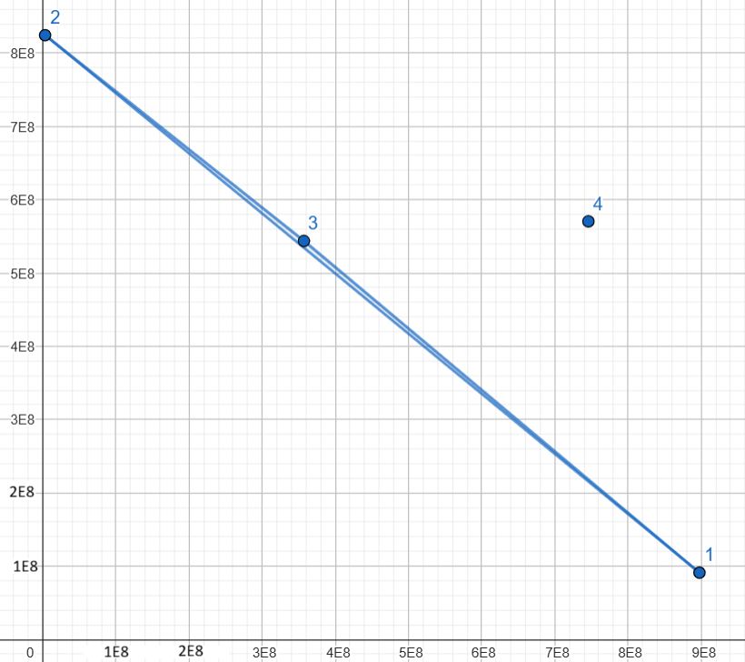

<br>

Андреј је ученик веома познате школе. На последњем писменом из програмирања је добио веома занимљив задатак. Толико му се свидео да је одлучио да га зада свом пријатељу Павлу.
<br>
Андреј је на табли нацртао $N$ тачака у координатној равни. Занимљиво је да их је нацртао тако да не постоје $3$ колинеарне тачке и да све тачке имају парне координате. Након тога је дефинисао конвексни омотач и конвексни скоро омотач скупа тачака. 

<br>

Конвексни омотач дефинишемо као конвексни многоугао најмање површине који садржи **свих** $N$ тачака. Тачке могу бити на ивици, или у унутрашњости многоугла.

<br>

Конвексни скоро-омотач дефинишемо као конвексни многоугао најмање површине који садржи **барем** $N-1$ датих тачака, али не нужно све. Тачке могу бити на ивици, или у унутрашњости многоугла.

<br>

Павлов задатак? Павле треба да нацрта **конвексни скоро-омотач** датог скупа тачака. Помозите Павлу тако што ћете му рећи његову површину.

<br>

## Опис улаза

<br>

У првој линији стандардног улаза дат је број $N$ - број тачака у равни.

<br>

У $i$-тој од следећих $N$ линија налазе се бројеви $x_i$ и $y_i$ - координате $i$-те тачке. 

<br>

Гарантује се да су све координате тачака парни бројеви и да не постоје $3$ колинеарне тачке.

<br>

## Опис излаза

<br>

У једној линији стандардног излаза испишите један цео број - површину конвексног скоро-омотача датих тачака.

<br>

Може да се докаже из услова задатка да ће та површина увек бити цео број.

<br>

## Пример 1

<br>

### Улаз

<br>

```
5
2 4
18 10
6 20
14 12
20 4
```

<br>

### Излаз

<br>

```
26
```

### Објашњење

<br>

Конвексни скоро-омотач је троугао који се састоји од тачака ($18$,$10$), ($6$,$20$) и ($20$,$4$). Његова површина је $26$.
<br>
Тачке као и конвексни скоро-омотач можете да видите на слици испод.
<br>

<br>
## Пример 2

<br>

### Улаз

<br>

```
7
4 18
18 10
6 18
8 4
2 4
14 10
16 6
```

<br>

### Излаз

<br>

```
104
```

### Објашњење

<br>
Конвексни скоро-омотач је петоугао који се састоји од тачака ($4$,$18$), ($6$,$18$), ($18$,$10$), ($16$,$6$) и ($8$,$4$). Његова површина је $104$.
<br>
Тачке као и конвексни скоро-омотач можете да видите на слици испод.
<br>



<br>

## Пример 3

<br>

### Улаз

<br>

```
4
897759290 91195278
3106330 824428456
356965620 543776038
745791392 570501492
```

<br>

### Излаз

<br>

```
4187427638333170
```

### Објашњење

<br>

Конвексни скоро-омотач је троугао који се састоји од тачака
($897759290$, $91195278$), ($3106330$, $824428456$) и ($356965620$, $543776038$), односно, прве $3$ тачке на улазу. Његова површина је $4187427638333170$.
<br>
Тачке као и конвексни скоро-омотач можете да видите на слици испод.
<br>

<br>
## Ограничења


<br>


- $4 \le N \le 10^5$ 

- $2 \le x_i,y_i \le 10^9$, за $1 \le i \le N$

- $(x_i, y_i) \neq (x_j, y_j)$, за $1 \le i < j \le N$

- $x_i$ и $y_i$ су парни, за $1 \le i \le N$

- Не постоје $3$ колинеарне тачке.


<br>

Тест примери су подељени у $7$ дисјунктних група:


   - У тестовима вредним $8$ поена: важи $N=4$
   - У тестовима вредним $12$ поена: важи да дужи између тачака $i$ и $i+1$ за $1 \le i < N$ и дуж између тачака $N$ и $1$ су странице конвексног $N$-тоугла.
   - У тестовима вредним $8$ поена: важи $N \le 500$
   - У тестовима вредним $12$ поена: важи $N \le 2000$
   - У тестовима вредним $12$ поена: важи да конвексни омотач има **највишe** $10$ страница.
   - У тестовима вредним $20$ поена: важи да конвексни омотач има **најмање** $N-100$ страница.
   -  У тестовима вредним $28$ поена: нема додатних ограничења.

<br>


## Напомена
<br>
Површина конвексног скоро-омотача може да буде веома велика - бројчано скоро $10^{18}$.
<br>
