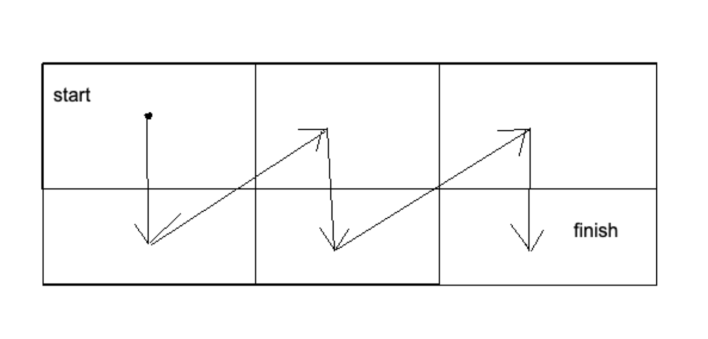

<br>

Ко нема срећу у љубави, има у матрици!

<br>

Перица има матрицу $A$ димензија $2 \times N$. Њене колоне можемо нумерисати бројевима од $1$ до $N$ читано слева надесно. Њене редове можемо нумерисати бројевима $1$ и $2$, гледајући одозго надоле. Поље $(i,j)$ припада $i$-том реду и $j$-ој колони. У пољу $(i,j)$ уписана је вредност $A[i][j]$.

<br>

Након што је признао својој симпатији и добио негативан одговор, Перица је одлучио да у потпуности жели да се посвети својој матрици. Он ће, наиме, започети кретање у пољу $(1,1)$, а завршиће га у пољу $(2,N)$. Само померање врши као на слици испод.

<br>

  

<br>

Формално, нека је Перица тренутно у пољу $(i,j)$. Наредно поље на које ће скочити је:

* $(2,j)$; уколико је $i=1$.
    
* $(1,j+1)$; уколико је $i=2$ и $j<N$.
    
* Кретање се завршава са крајем у пољу $(2,N)$.

<br>

На почетку, Перичина срећа износи $0$ (ипак га је симпатија одбила). Сваки пут када се приликом кретања деси да вредност његовог тренутног поља има исту парност као и вредност његовог претходног поља, Перичина срећа порасте за $1$. Напомињемо да поље $(1,1)$ нема претходника.

<br>

Како би био што срећнији, Перица ће извршити произвољан коначан број (можда $0$) потеза **искључиво пре него што започне кретање**. У једном потезу, он може:
	 
* Изабрати $i$ такво да је $1 \leq i \leq N$.
    
* Заменити вредности $A[1][i]$ и $A[2][i]$.

<br>

Након што Перица изврши потезе, започеће кретање као што је раније описано.

<br>

Помозите Перици и испишите највећу могућу срећу кретања након извршавања поменутих потеза.

<br>

## Опис улаза

<br>

Најпре, прва линија стандардног улаза садржи $T$ - број тестова у оквиру једног тест примера. Затим се уносе ти тестови у наредном формату:

<br>

Прва линија сваког теста садржи један природан број $N$.

<br>

Друга линија сваког теста садржи $N$ природних бројева $A[1][1], A[1][2], \ldots , A[1][N]$.

<br>

Трећа линија сваког теста садржи $N$ природних бројева $A[2][1], A[2][2], \ldots , A[2][N]$.

<br>

## Опис излаза

<br>

За сваки тест, исписати један број у засебној линији - одговор на задатак.

<br>

## Пример 1

<br>

### Улаз

<br>

```
2
4
1 3 8 9
2 8 6 6
2
1 2
3 4
```

<br>

### Излаз

<br>

```
4
2
```

<br>

### Објашњење

<br>

У првом тесту, Перица узима $i=1$ и $i=4$. Над њима изврши по један потез. Његово кретање посећује поља $(1,1), (2,1), (1,2), (2,2), (1,3), (2,3), (1,4), (2,4)$ са вредностима, редом, $2,1,3,8,8,6,6,9$. При таквом, његова срећа износи $4$. Може се доказати да је та срећа и највећа могућа.

<br>

У другом тесту, Перица не мора извршити ниједан потез. Његова срећа је $2$.

<br>

## Пример 2

<br>

### Улаз

<br>

```
4
7
1 2 3 4 5 6 7
8 9 10 11 12 13 14
3
1000 3000 1500
4000 6000 2000
10
1 9 3 4 2 8 3 4 1 2
3 9 2 4 5 3 9 6 2 4
4
1000000000 1000000000 999999999 999999999
1000000000 999999999 1000000000 1000000000
```

<br>

### Излаз

<br>

```
6
5
12
4
```

<br>

## Ограничења

<br>

* $1 \leq T \leq 1\,000$

* $2 \leq N \leq 200\,000$

* $1 \leq A[i][j] \leq 10^9$

* Укупан збир вредности $N$ у свим тестовима не прелази $200\,000$.

<br>

Тест примери су подељени у пет дисјунктних група:

* У тестовима вредним 10 поена: $A[i][j]=1$ за све $1\leq i \leq 2$ и $1\leq j \leq N$.

* У тестовима вредним 10 поена: $N = 2$.

* У тестовима вредним 10 поена: $N = 3$.

* У тестовима вредним 30 поена: $N \leq 10$.

* У тестовима вредним 40 поена: Без додатних ограничења.

<br>
