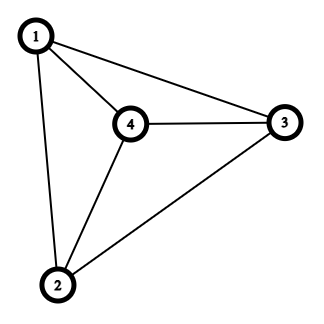
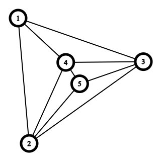
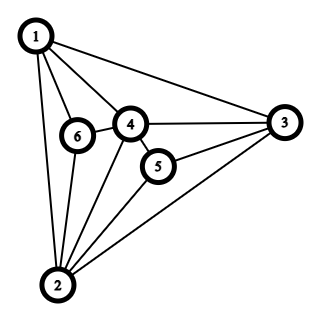

<br>

Васпитачица Милица је одлучила да оде у новогодишњу куповину поклона за децу из вртића. Како није најупознатија са географијом и геометријом града, одлучила је да користи једну од многобројних алтернативних апликација за проналажење најбоље руте. Наравно, како то обично бива са неискусним корисницима и алтернативним апликацијама, Милица се начисто изгубила у овом логистичком лавиринту и потребна јој је помоћ!

<br>


У граду постоји $n$ продавница, а на почетку дана Милица се налази у продавници означеној бројем $1$. Неке од продавница су повезане улицама и Милица жели да се креће само тим улицама. Такође, Милица жели да посети **сваку продавницу тачно једном** и **да се врати у продавницу $1$ на крају**. 

<br>

Продавнице су повезане на специфичан начин, из историјско-грађевинских разлога. Приликом оснивања самог града настале су продавнице $1$, $2$ и $3$, које су све међусобно повезане улицама. Затим, када је настала продавница број $4$, саграђена је унутар троугла продавница $1,2,3$ и повезана је улицама са све три продавнице. Даље, за сваку наредну продавницу $x = 5, 6, \ldots, n$ биран је троугао $abc$ (за $a,b,c = 1,2,3,\ldots,x-1$) продавница који унутар себе нема ниједну продавницу и у њему је саграђена продавница $x$ и повезана са све три продавнице $a,b,c$. Додатно, познато је да када се продавница $x = 4,5,\ldots, n$ сагради унутар троугла $abc$, **барем један од троуглова** $abx$, $acx$ или $bcx$ **неће имати убудуће саграђену продавницу унутар себе**. За разјашњење, погледајте слику.  

<br>

Ваш задатак је да испишете путању продавница којом васпитачица Милица може да обиђе све продавнице тачно једном, или $-1$ уколико таква путања не постоји. Уколико постоји више решења, исписати било које.
 
<br>

## Опис улаза

<br>

У првој линији стандардног улаза дат је цео број $n$, број продавница у граду.

<br>

У наредних $n-4$ линија стандардног улаза, налази се по три цела броја - $a, b, c$. Свака од ових линија описује да се наредна продавница (продавнице се граде редом по броју $5, 6, \ldots, n$) гради унутар троугла продавница $a,b,c$. 

<br>

## Опис излаза

<br>

Уколико решење не постоји, исписати $-1$.

<br>

Иначе, једној линији стандардног излаза испишите $n+1$ целих бројева. $i$-та вредност представља продавницу коју Милица обилази $i$-ту по реду. Први и последњи број треба бити једнак $1$.

<br>

## Пример 1

<br>

### Улаз

<br>

```
6
3 2 4
1 2 4
```

<br>

### Излаз

<br>

```
1 2 6 4 5 3 1
```

### Објашњење

<br>

На почетку је било само четири продавница, као на слици испод:



Затим, саградила се продавница $5$ у троуглу $2,3,4$, као на слици испод:



На крају, саградила се и продавница $6$ у троуглу $1, 2, 4$, као на слици испод:



Обратите пажњу да колико год да је још продавница грађено, троугао $1,3,4$ би остао празан у смислу да се ниједна продавница не би ту градила. Ово се гарантује текстом задатка. Сада један од путева који Милица може да изабере је од продавнице $1$ до продавнице $2$, затим од продавнице $2$ до продавнице $6$, затим од продавнице $6$ до продавнице $4$, затим од продавнице $4$ до продавнице $5$, затим од продавнице $5$ до продавнице $3$. На крају, потребно је да се врати од продавнице $3$ до продавнице $1$. На овај начин Милица обилази сваку продавницу тачно једном и враћа се у продавницу $1$.
 
<br>

## Пример 2

<br>

### Улаз

<br>

```
7
1 3 4
3 4 5
1 5 3
```

<br>

### Излаз

<br>

```
1 2 3 4 6 5 7 1
```

<br>

## Ограничења


<br>


- $4 \leq n \leq 200.000$ 


<br>

Тест примери су подељени у $5$ дисјунктних група:


   - У тестовима вредним $10$ поена: важи $n \leq 10$.
   - У тестовима вредним $10$ поена: важи $n \leq 20$.
   - У тестовима вредним $15$ поена: важи да ће продавница свака нова продавница $x = 5,6,\ldots,n$ бити саграђена у троуглу $1,2,x-1$.
   - У тестовима вредним $15$ поена: важи $n \leq 100$.
   - У тестовима вредним $20$ поена: важи $n \leq 1.000$.
   - У тестовима вредним $30$ поена: без додатних ограничења.

<br>
