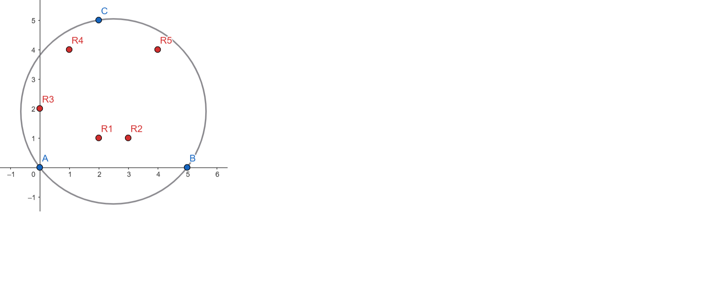
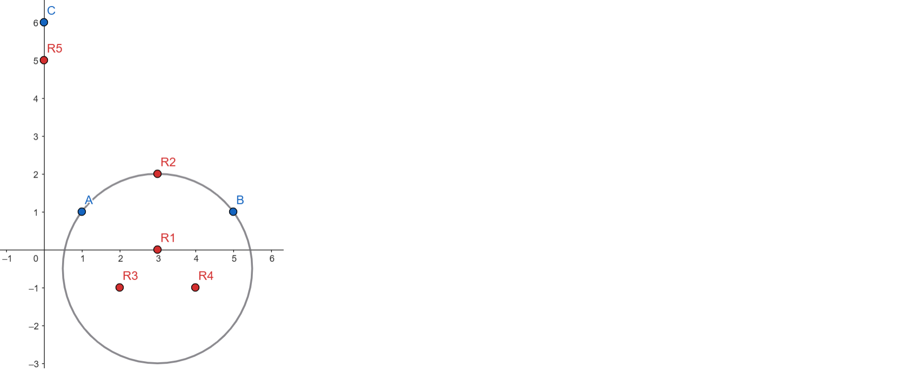

<br>

Божа Дунстер, селектор репрезентације Србије на ИОИ-у (Имплементирање Офсајд Интелигенције) која се одржава у Сукреу, има свог верног голуба Радоја. Наравно, ни Радоје не иде тамо само ради провода, већ је добио озбиљно задужење од Боже.

<br>

Наиме, Божа је сазнао да ће свим такмичарима у Сукреу бити додељен по лист лековите биљке, како би се борили против висинске болести. Ипак, због лоше организације, репрезентација Србије ће добити само $3$ листа, а поред та три листа, постоји још њих $n$ намењено осталим репрезентацијама. Сво лишће (њих $n+3$) се налази на једном огромном столу. 

<br>

Задатак који је добио Радоје јесте да украде што је више лишћа са стола могуће, а да притом не покупи ниједан лист намењен српском тиму. Наравно, Радоје је само голуб (а не на пример, сврака) и може да краде на врло специфичан начин. Он жели да изабере круг произвољног центра и полупречника на столу за који важи:
1) да нема **ниједан** српски лист у својој **строгој унутрашњости**,
2) да максимизује број туђег лишћа **у кругу или на њему**.

<br>

Нажалост, Радоје има само једну прилику у Сукреу, тако да ће морати да вежба са Божом док су још увек у Србији. Како би били сасвим сигурни у Радоја, Радоје мора да реши $T$ различитих примера, где у сваком примеру добије број $n$ и $n+3$ тачака у равни које представљају лишће и за сваки пример решава описани задатак.
 
<br>

Помозите Радоју.

## Опис улаза

<br>

У првој линији стандардног улаза дат је природан број $T$, број примера.

<br>

Сваки од $Т$ примера је описан на следећи начин:

- Прва линија примера садржи природан број $n$ - број туђег лишћа
- Наредне три линије примера садрже по два цела броја. Свака од тих линија представља $x$ и $y$-координате српског лишћа.
- Затим, наредних $n$ линија примера садржи по два цела броја. Свака од тих линија представља $x$ и $y$-координате туђег лишћа.

**Гарантује се да никоја три листа (било које припадности) нису колинеарна.**

<br>

## Опис излаза

<br>

За сваки од $T$ упита треба исписати једну линију стандардог излаза која садржи један цео број - највећи број лишћа које Радоје може да украде.

<br>

## Пример 1

<br>

### Улаз

<br>

```
1
5
0 0
5 0
2 5
2 1
3 1
0 2
1 4
4 4
```

<br>

### Излаз

<br>

```
5
```

### Објашњење

<br>
 
Нека су плаве тачке оне које представљају српско лишће, док су црвене оне које представљају лишће других репрезентација. Радоје може да посматра описани круг плавих тачака и на тај начин ће украсти све црвене тачке, што је свакако максимум. Можете погледати пример на слици:


<br>

## Пример 2

<br>

### Улаз

<br>

```
1
5
1 1
5 1
0 6
2 -1
4 -1
3 0
3 2
0 5
```

<br>

### Излаз

<br>

```
4
```

<br>

### Објашњење

<br>
 
Нека су плаве тачке оне које представљају српско лишће, док су црвене оне које представљају лишће других репрезентација. Радоје може да посматра описани круг око тачака $A$, $B$ и $R_2$ и на тај начин ће украсти четири црвене тачке (сетите се да се црвена тачка рачуна као украдена и ако је на обиму круга). Могуће је показати да Радоје не може да украде свих пет листова. Можете погледати пример на слици:


<br>

## Ограничења


<br>


- $1 \leq T \leq 1000$
- $1 \leq n \leq 10^{5}$ 
- Апсолутне вредности $x$ и $y$ координата свог лишћа је највише $10^9$
- Гарантује се да никоја три листа (било које припадности) нису колинеарна.

Гарантује се да укупан број тачака у свим примерима не прелази $2\cdot10^5$.

<br>

Тест примери су подељени у $8$ дисјунктних група:

   
   - У тестовима вредним $2$ поена: Сво лишће туђих репрезентација се налази у троуглу који формирају листови репрезентације Србије.
   - У тестовима вредним $5$ поена: Постоји неки максимални скуп $S$ лишћа који Радоје може да украде и који се налази у  кругу који формирају листови репрезентације Србије и апсолутне вредности координата су највише $10^6$.
   - У тестовима вредним $10$ поена: важи $n \leq 10$ и $T \leq 10$ и апсолутне вредности координата су највише $10^6$.
   - У тестовима вредним $15$ поена: Нека је неки $S$ максимални скуп лишћа који Радоје може да украде. Постоји права којој је са једне стране скуп $S$, а са друге стране лишће репрезентације Србије. 
   - У тестовима вредним $13$ поена: важи $n \leq 80$ и $T \leq 5$ и апсолутне вредности координата су највише $10^6$.
   - У тестовима вредним $15$ поена: важи $n \leq 300$ и $T \leq 5$ и апсолутне вредности координата су највише $10^6$.
   - У тестовима вредним $17$ поена: важи $n \leq 3000$ и $T \leq 5$ и апсолутне вредности координата су највише $10^6$.
   - У тестовима вредним $23$ поена: без додатних ограничења.

<br>
