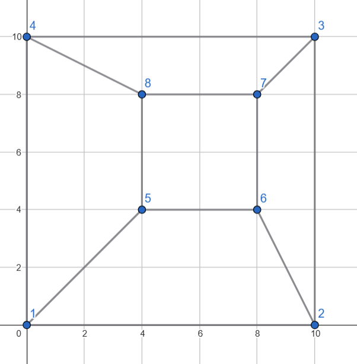

 

Најбољи фудбалер свих времена, Лионел Меси, нашао се у сличној ситуацији као Моша Марјановић. Достигао је засићење од фудбала, јер је освојио све што је било у понуди. Поучен искуством које је имао Моша, одлучио је да игра фудбал с децом у селу Јотала.

 

У том селу, деца су јако загрижена за фудбал, па имају постављене чуњеве на терену, који можемо да замислимо као раван. За сваки од $n$ чуњева познате су координате $x_i$ и $y_i$ на којима се налазе. Додатно, финансијска ситуација у Јотали није на завидном нивоу, тако да је терен скоро па уништен. Постоји  $m$ коридора по којима може да се Меси креће и сваки од њих повезује тачно два чуња. Коридори су праве линије и **никоја два коридора се не секу**.

Додатно, сваки чуњ је директно **повезан са још бар три** друга чуња коридорима. 

 

Да би показао своју вештину, Меси ће кренути од произвољног чуња и кретаће се по коридорима и обилазиће чуњеве док се не врати у почетни. То обично јако усрећи децу. Ипак, због огромне надморске висине, Меси не жели да се сувише умори, па вас моли да пронађете најкраћу путању коридорима која креће од једног чуња обилази неке друге чуњеве и враћа се у почетни, тако да сваки коридор прође највише једном.

 

На овај начин Лео ће пронаћи своју љубав према фудбалу поново, а ви вашу према информатици.

 

## Описи функција

 

Потребно је да имплементирате функцију

 

- $Mesi(n, m, x[\ldots], y[\ldots], a[\ldots], b[\ldots])$

 

**Ова функција ће бити позвана $T$ пута по примеру.** Број $n_i$ представља број чуњева, а $m_i$ број коридора у $i$-том позиву функције. 

 

Низ $x$ представља низ $x$-координата чуњева. Низ $y$ представља низ $y$-координата чуњева.

 

Низови $a$ и $b$ представљају чуњеве које коридори повезују. Прецизније, коридор $i$ повезује чуњеве $a[i]$ и $b[i]$ . Гарантује се да се никоја два коридора не секу.

 

Потребно је вратити један цео број, најкраћу путању коридорима која креће и завршава се у истом чуњу. 

 

**Сви низови су индексирани од 1.**

 

## Пример

 

Нека је:
- $n=8$, $m=12$
- $x=\{0, 10, 10, 0, 4, 8, 8, 4\}$
- $y=\{0, 0, 10, 10, 4, 4, 8, 8\}$
- $a=\{1, 2, 3, 4, 5, 6, 7, 8, 1, 2, 3, 4\}$
- $b=\{2, 3, 4, 1, 6, 7, 8, 5, 5, 6, 7, 8\}$.

 

Пре свега погледајмо визуелну репрезентацију терена са чуњевима и коридорима:

 

Најкраћа тражена путања је дужине 4 и имамо више таквих. На пример: $1\rightarrow 2\rightarrow 3 \rightarrow 4 \rightarrow 1$ или $1\rightarrow 2\rightarrow 6 \rightarrow 5 \rightarrow 1$ итд.

 

Потребно је, дакле, вратити 4.

 

## Ограничења

 

* $4 \leq \sum_{j=1}^T n_j  \leq 100.000$
* $0 \leq m_j \leq 300.000$
* $0 \leq x[i] \leq 10^9$, за $i = 1, 2, \ldots, n$
* $0 \leq y[i] \leq 10^9$, за $i = 1, 2, \ldots, n$
* $1 \leq a[i] \leq n$, за $i = 1, 2, \ldots, m$
* $1 \leq b[i] \leq n$, за $i = 1, 2, \ldots, m$

 

## Подзадаци

 

Тест примери су подељени у $8$ подзадатка:

 

-   **[2 поена]:** $\sum_{j=1}^T n_j \leq 10$
-   **[3 поена]:** $\sum_{j=1}^T n_j  \leq 20$
-   **[10 поена]:** $\sum_{j=1}^T n_j  \leq 100$
-   **[10 поена]:** Решење је непаран број
-   **[15 поена]:** $\sum_{j=1}^T n_j  \leq 5000$
-   **[20 поена]:** Сваки чуњ је директно повезан са највише још пет других чуњева коридорима
-   **[15 поена]:** Постоје барем два чуња између којих најкраћи пут има барем $25$ коридора 
-   **[25 поена]:** Нема додатних ограниченња

 

## Детаљи имплементације

 

Потребно је да пошаљете тачно један фајл  `mesi.cpp`  који имплементира поменуте функције. Осим тражених функција, ваш фајл може садржати и додатне глобалне променљиве, помоћне функције и додатне библиотеке.

 

Ваша функција мора бити следећег облика:

 

`int Mesi(int n, int m, int* x, int* y, int* a, int* b);`

 

**Вашим програмима је дозвољено да мењају садржај низова али не смеју да приступају ван граница датих низова.**

 

Уз задатак, обезбеђен вам је "template" фајл  `code.cpp`  који можете користити и мењати по потреби. Такође вам је обезбеђен програм  `grader.cpp`  који служи да лакше тестирате кодове. Овај програм учитава са стандардног улаза следеће податке:

 

- У првом реду бројеви $n$ и $m$.
- У наредних $n$ редова по два броја $x[i]$ и $y[i]$.
- У наредних $m$ редова по два броја $a[i]$ и $b[i]$.

 

Затим овај програм зове вашу функцију и исписује резултат који ваша функција врати.
