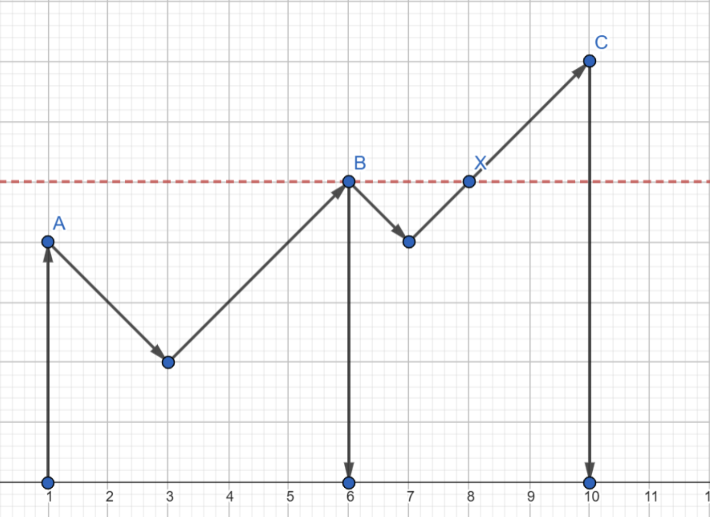

<br> Џек Врабац је освојио нови дводимензионални брод, по имену Левитирајући Тамњаничар. Брод можемо представити као Декартов координатни систем тако да је прамац на $(0,0)$ а крма на $(10^9,0)$. На броду има $n$ јарбола који се налазе на удаљеностима $x_1, x_2,\dots ,x_n$ од прамца брода и њихове висине су $h_1, h_2,\dots ,h_n$. Између два суседна јарбола везан је магични канап. Канап посматрамо као линију која до једног тренутка има нагиб $-1$, а одатле $+1$ (погледати слику, игнорисати стрелице). Гарантује се да је увек могуће повезати два суседна јарбола магичним канапом и да ће постојати тачка промене нагиба. Можемо приметити да се то онда може урадити на јединствен начин. Џека интересује за сваки јарбол колико му је близу најближи део на броду (тачка на јарболу или канапу) који је барем те висине. Ако нема таквог, исписати -1. <br>
## Опис улаза  
У првој линији стандардног улаза дат је цео број $n$, број јарбола. <br> У другој линији дато је $n$ целих бројева $x_1,x_2,\dots ,x_n$ који представљају удаљености јарбола од прамца брода. 
У трећој линији дато је $n$ целих бројева $h_1,h_2,\dots ,h_n$ који представљају висине јарбола.
## Опис излаза  
Исписати $n$ линија. У линији $i$ уколико не постоји део брода кој задовољава услов за јарбол $i$ исписати $-1$, а ако постоји исписати удаљеност између врха јарбола $i$ и тог дела. 
## Пример 1
### Улаз
 ```
 3 
1 6 10 
4 5 7
``` 
### Излаз  
 ```
4
2
 -1
 ```  
### Објашњење  
Слика одговара оввом примеру. Јарболи су обележени са $A,B,C$ . Тачка $X$ је најближа тачка која је виша или једнака од $B$. За $C$ немамо такву, а за $A$ ће бити тачка (5,4).
 <br> <br><br>

## Ограничења  
- $1 \leq n \leq 10^6$  
- $0 \leq x_i,h_i \leq 10^{9}$
- $x_i \neq x_j$ за $i \neq j$
- Гарантује се да је могуће везати магични канап између свака два суседна јарбола
- Гарантује се за сваки магични канап да ако мења свој нагиб онда га мења у целобројној тачки

Тест примери су подељени у $3$ дисјунктних група:
 - У тестовима вредним $50$ поена: важи $n \leq 1000$.
 -  У тестовима вредним $20$ поена: важи $n \leq 200000$.
 - У тестовима вредним $30$ поена: без додатних ограничења. 

## Напомена
Низ $x$ није нужно сортиран.
