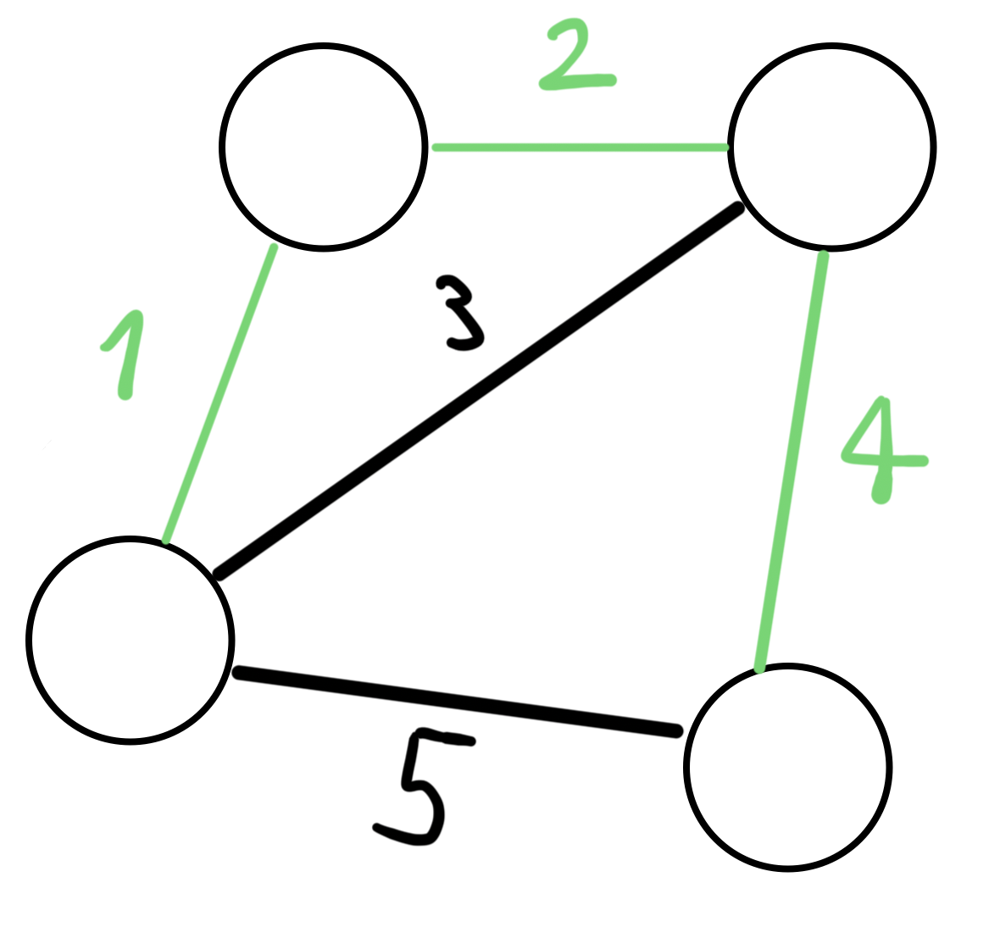

Година је 4096. и управо се у Бајтграду (главни град планете Сендбокс) догодила интергалактичка изложба технолошких достигнућа. Ту је Амазон представио најновију верзију свог система вештачке генералне интелигенције Алекса. Једна од многобројних могућности новог система је да решава саобраћајне проблеме.

<br>

Алексина прва идеја је била да скроз измени саобраћајну мрежу Бајтграда. Она је одлучила да за почетак све тренутне улице блокира монтажним објектима од јавног значаја у којима ће бити организоване трибине, биоскоп на отвореном, јавне дискусије... Нова мрежа ће се састојати од тачно $N$ кружних токова који су повезани са тачно $M$ улица. Локације кружних токова је Алекса већ одредила, међутим има потешкоћа око избора улица између њих, и ту јој је потребна Ваша помоћ.

<br>

Алекса је већ расписала тендер за материјале за нове улице и, како је Сендбокс изолована планета, само се једна фирма јавила, и то са следећом понудом: Добићете низ $A$ који се састоји од $М$ бројева и путеви које изградите ће имати квалитет калдрме (већи број значи већи квалитет) искључиво из тог низа, без понављања. Како је Сендбокс далека планета, она није ништа налик свету који ми познајемо и за изградњу пута између било која два кружна тока је потребна иста количина материјала, тако да пут било ког квалитета можете да изаберете да изградите између било која два кружна тока.

<br>

Путеве морамо да изградимо тако да може да се дође од било ког кружног тога до било ког другог кружног тока, да не постоји више путева између два иста кружна тока, и познато је да ће од изграђених путева, становници Бајтграда изабрати за кретање само део (подскуп) њих ти то на следећи начин:

1. унутар изабраног дела путева (без коришћења осталих путева) мора да може да се дође од било ког кружног тога до било ког другог кружног тока
2. не постоји други део путева такав да је његов збир квалитета калдрме мањи од изабраног

<br>

Алекса верује да ако је становницима теже да се крећу кроз град да ће бити мање гужве, стога жели да ми изаберемо $М$ путева и доделимо им квалитете калдрма из $А$ тако да део путева који становници буду изабрали за кретање има што већи збир квалитета калдрма (буду што гори за кретање) и испишемо само тај збир.

<br>

Формално: Дате су тежине $М$ грана и треба исписати највећу тежину [најмањег разапињућег стабла](https://sr.wikipedia.org/wiki/%D0%A0%D0%B0%D0%B7%D0%B0%D0%BF%D0%B8%D1%9A%D1%83%D1%9B%D0%B5_%D1%81%D1%82%D0%B0%D0%B1%D0%BB%D0%BE_%D0%BC%D0%B8%D0%BD%D0%B8%D0%BC%D0%B0%D0%BB%D0%BD%D0%BE%D0%B3_%D1%81%D1%82%D0%B5%D0%BF%D0%B5%D0%BD%D0%B0) [повезаног простог графа](https://sh.wikipedia.org/wiki/Teorija_grafova) са $N$ чворова и $M$ грана датих тежина.

## Опис улаза

<br>

У првој линији стандардног улаза налазе се бројеви $N$ и $M$ који редом представљају број кружних токова и број путева који треба изградити. У другој, и последњој, линији се налази $М$ бројева, који представљају квалитете калдрме $M$ путева које треба изградити.

<br>

## Опис излаза

<br>

На прву и једину линију стандардног излаза исписати један број који представља највећи могући збир квалитета калдрме на делу путева који изаберу становници када тактички изаберемо како ћемо изградити путеве.

<br>

## Пример 1

<br>

### Улаз

<br>

```
4 5
1 2 3 4 5
```

<br>

### Излаз

<br>

```
7
```

<br>

### Објашњење примера

<br>

Имамо 4 кружна тока и градимо 5 путева. Ако изградимо путеве као на слици, становници ће за кретање изабрати путеве са квалитетом калдрме $1$, $2$ и $4$, чији је збир $7$. Може се доказати да је немогуће направити већи збир, па је решење $7$.



<br>

## Ограничења

<br>

* $1 \leq N-1 \leq M \leq 200\,000$
* $1 \leq A_i \leq 10^9$
* $M \leq \frac{N\cdot \left(N-1\right)}{2}$

<br>

Тест примери су подељени у четири дисјунктне групе:
* У примерима вредним 10 поена: $M=N-1$
* У примерима вредним 10 поена: $M=N$
* У примерима вредним 20 поена: $M=N+9$
* У примерима вредним 60 поена: нема додатних ограничења
